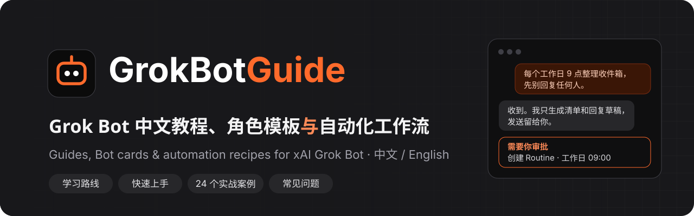
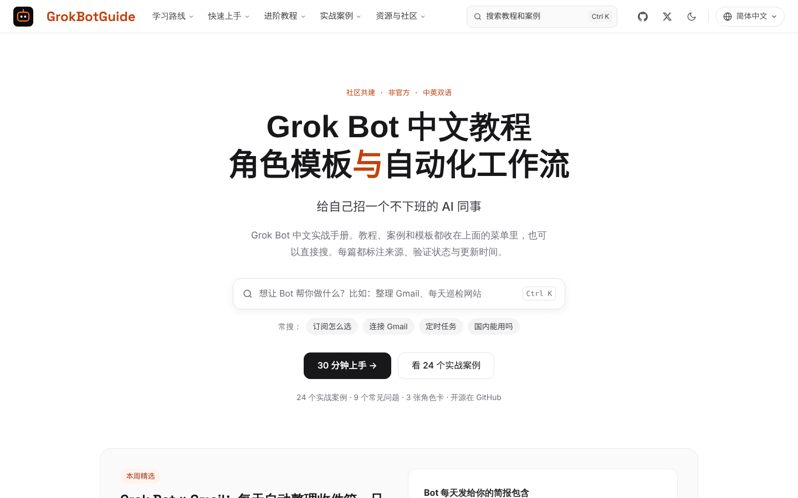
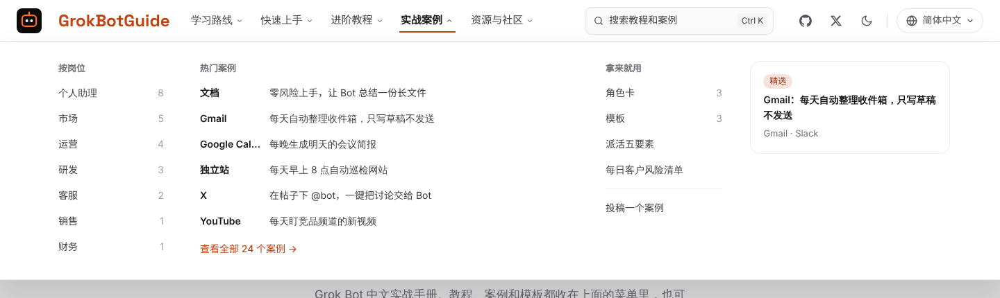
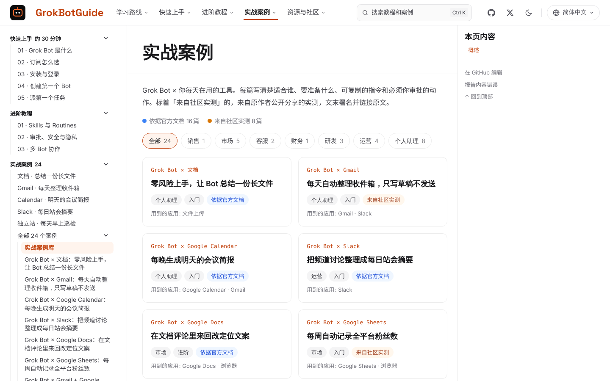
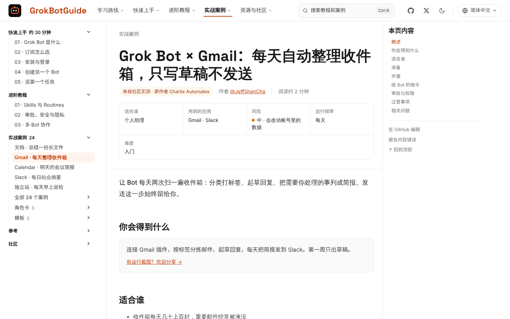
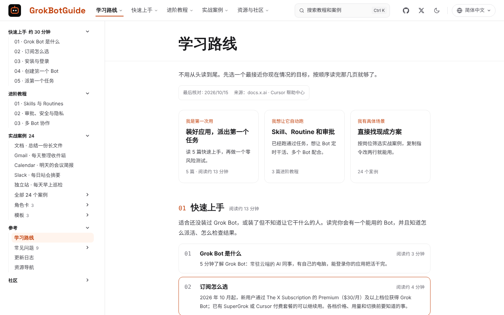
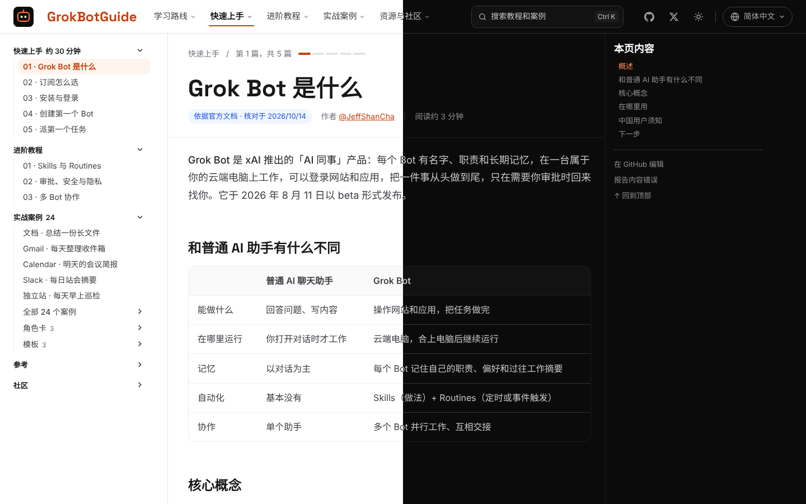
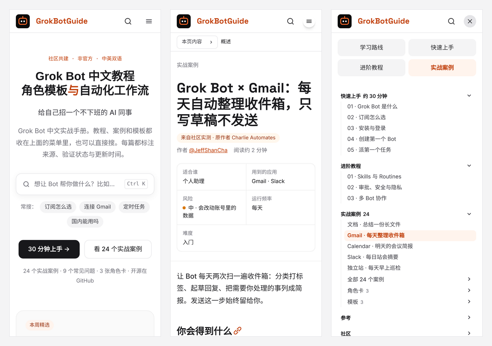

<p align="center">
  <a href="https://grokbotguide.ai/zh/"></a>
</p>

<h3 align="center">面向中文用户的 xAI Grok Bot 实战手册：教程、角色卡、模板和「Grok Bot × 工具」实战案例</h3>

<p align="center">
  <a href="https://grokbotguide.ai/zh/"></a>
  <a href="https://github.com/JeffShanCha/grokbotguide/stargazers"></a>
  <a href="https://github.com/JeffShanCha/grokbotguide/network/members"></a>
  <a href="https://github.com/JeffShanCha/grokbotguide/issues"></a>
  <a href="./LICENSE"></a>
  <a href="./CONTENT_LICENSE.md"></a>
  <a href="./CONTRIBUTING.md"></a>
</p>

<p align="center">
  简体中文
  ·
  <a href="./README_en.md">English</a>
  ·
  <a href="https://grokbotguide.ai/zh/">在线阅读</a>
  ·
  <a href="https://grokbotguide.ai/zh/guide/">学习路线</a>
  ·
  <a href="https://grokbotguide.ai/zh/start/what-is-grok-bot/">快速上手</a>
  ·
  <a href="https://grokbotguide.ai/zh/advanced/skills-and-routines/">进阶教程</a>
  ·
  <a href="https://grokbotguide.ai/zh/recipes/">实战案例</a>
  ·
  <a href="https://grokbotguide.ai/zh/answers/">常见问题</a>
</p>

> 从装好第一个 Bot，到让它每天替你整理收件箱、巡检网站、盯竞品、写周报。
> 每篇都标注来源、核对日期和内容分级。如果这个项目帮你省下了摸索时间，欢迎点亮 Star，让更多人看到它。

## 在线网站

**GrokBotGuide 的在线阅读地址是 [grokbotguide.ai](https://grokbotguide.ai/zh/)。** 中文在 `/zh/`，英文在 `/en/`，打开根域名会按你的地区自动跳转，也可以在右上角随时切换。

<p align="center">
  <a href="https://grokbotguide.ai/zh/">
    
  </a>
</p>

README 适合快速了解项目，真正学习时更推荐打开网站：网站有站内搜索、顶部下拉导航、侧边栏目录、阅读进度、可一键复制的指令模板和中英文切换。

第一次接触 Grok Bot，直接从 [学习路线](https://grokbotguide.ai/zh/guide/) 开始；已经有具体场景，就去 [实战案例](https://grokbotguide.ai/zh/recipes/) 按岗位挑一个。

## 项目愿景

Grok Bot 不是又一个聊天框。它是 xAI 推出的「AI 同事」：每个 Bot 有自己的名字、职责和长期记忆，在一台属于你的云端电脑上登录网站和应用，把一件事从头做到尾，只在需要审批时回来找你。

这类产品最难的不是「会不会用」，而是「敢不敢交给它」。GrokBotGuide 想回答三个问题：

- **怎么开始**：选哪个订阅、怎么装、第一个 Bot 该负责什么、第一个任务怎么派。
- **怎么交给它**：怎样写清楚要求，哪些动作必须设成审批，怎么把跑通的流程存成 Skill 和定时 Routine。
- **怎么用到真实工作里**：Gmail、Slack、X、Notion、GitHub、Stripe、Google Ads……每个组合都给出步骤、可复制的指令和权限边界。

## 适合谁

- **第一次用 Grok Bot 的新手**：跟着 5 篇快速上手，约 30 分钟跑通从订阅到第一个任务的完整闭环。
- **想让 Bot 每天自动干活的人**：学会 Skills、Routines 和审批设置，把手动流程变成定时任务。
- **运营、市场、客服、销售、财务**：按岗位找现成方案，复制指令改两行就能用。
- **开发者和独立站站长**：GitHub PR 巡检、Cursor 云端 Agent 协作、每日网站巡检。
- **中国用户**：订阅、付款、网络环境和 X 上的 @grok 有什么区别，有一页专门讲清楚。

## 你会在这里看到什么

| 内容 | 说明 |
| --- | --- |
| [学习路线](https://grokbotguide.ai/zh/guide/) | 按「第一次用 / 想让它自动跑 / 有具体场景」分三条路，每条列出要读的页面和阅读时间 |
| [快速上手](https://grokbotguide.ai/zh/start/what-is-grok-bot/) | Grok Bot 是什么、订阅怎么选、安装登录、创建第一个 Bot、派第一个任务 |
| [进阶教程](https://grokbotguide.ai/zh/advanced/skills-and-routines/) | Skills 与 Routines、审批与安全、多 Bot 协作 |
| [实战案例](https://grokbotguide.ai/zh/recipes/) | 24 个「Grok Bot × 工具」案例，按岗位筛选，标注风险等级和运行频率 |
| [角色卡与模板](https://grokbotguide.ai/zh/bots/) | 写好的 Bot 职责描述、权限边界，以及派活指令、Skill、Routine 模板 |
| [常见问题](https://grokbotguide.ai/zh/answers/) | 怎么连接 Gmail、怎么设置定时任务、用不了怎么办、国内能不能用等 9 个高频问题 |
| [资源导航](https://grokbotguide.ai/zh/resources/) | 100 多条官方文档、作者博客、视频和 X 帖子，只写摘要并链接原文 |
| [更新日志](https://grokbotguide.ai/zh/news/changelog/) | Grok Bot 产品与订阅变化，每条附官方来源 |

## 网站一览

### 顶部导航：所有教程一步直达

五个下拉菜单把学习路线、快速上手、进阶教程、实战案例、资源与社区都收在顶部，热门案例和按岗位的篇数也在里面。

<p align="center">
  
</p>

### 实战案例库：按岗位挑现成方案

每张卡片拆成「Grok Bot × 工具」和一句话用途，标出岗位、难度和来源分级，点岗位标签就能筛选。

<p align="center">
  
</p>

### 案例文章：一眼看清风险和频率

标题下的摘要格写明适合谁、用到的应用、风险等级、运行频率和难度；正文固定为准备、步骤、可复制指令、审批与权限、注意事项。

<p align="center">
  
</p>

### 学习路线：先选目标，再按顺序读

<p align="center">
  
</p>

### 浅色、深色和手机端

<p align="center">
  
</p>

<p align="center">
  
</p>

## 推荐阅读路径

### 1. 第一次上手

先读 [Grok Bot 是什么](https://grokbotguide.ai/zh/start/what-is-grok-bot/)，再看 [订阅怎么选](https://grokbotguide.ai/zh/start/plans/)、[安装与登录](https://grokbotguide.ai/zh/start/install/)、[创建第一个 Bot](https://grokbotguide.ai/zh/start/first-bot/) 和 [派第一个任务](https://grokbotguide.ai/zh/start/first-task/)。读完先跑一遍 [零风险案例：让 Bot 总结一份长文件](https://grokbotguide.ai/zh/recipes/summarize-a-document/)，不需要连接任何应用。

### 2. 想让它每天自动跑

从 [Skills 与 Routines](https://grokbotguide.ai/zh/advanced/skills-and-routines/) 开始，设定时任务之前一定先读 [审批、安全与隐私](https://grokbotguide.ai/zh/advanced/approvals-and-security/)，需要多个 Bot 配合时再看 [多 Bot 协作](https://grokbotguide.ai/zh/advanced/teams-of-bots/)。

### 3. 有具体场景

打开 [实战案例库](https://grokbotguide.ai/zh/recipes/) 按岗位筛选，或者直接从这几篇开始：[Gmail 每天整理收件箱](https://grokbotguide.ai/zh/recipes/gmail-inbox-triage/)、[Slack 每日站会摘要](https://grokbotguide.ai/zh/recipes/slack-daily-standup/)、[每天早上巡检网站](https://grokbotguide.ai/zh/recipes/website-daily-check/)、[在 X 帖子下 @bot](https://grokbotguide.ai/zh/recipes/x-tag-bot/)。

## 快速入口

| 页面 | 适合解决什么问题 |
| --- | --- |
| [订阅怎么选](https://grokbotguide.ai/zh/start/plans/) | X 订阅、SuperGrok 还是 Cursor；各档价格和关联前必须知道的事 |
| [中国用户须知](https://grokbotguide.ai/zh/answers/grok-bot-in-china/) | 国内能不能用、怎么付款、和 X 上的 @grok 有什么区别 |
| [怎么连接 Gmail](https://grokbotguide.ai/zh/answers/how-to-connect-grok-bot-to-gmail/) | 授权步骤、只出草稿的权限设置、公司邮箱被拦怎么办 |
| [怎么设置定时任务](https://grokbotguide.ai/zh/answers/how-to-schedule-grok-bot-routines/) | 时区、最小间隔、Test run，以及 Routine 没运行的排查清单 |
| [用不了怎么办](https://grokbotguide.ai/zh/answers/grok-bot-not-working/) | 登录、云电脑、插件授权、@bot 没反应等常见问题的处理顺序 |
| [关掉电脑还能运行吗](https://grokbotguide.ai/zh/answers/does-grok-bot-work-when-laptop-is-closed/) | 云端电脑和本地电脑的区别 |
| [Grok Bot 安全吗](https://grokbotguide.ai/zh/answers/is-grok-bot-safe/) | 共享云电脑意味着什么，哪些动作一定要审批 |
| [派活五要素](https://grokbotguide.ai/zh/templates/five-part-request/) | 任何任务都能套用的指令模板 |

## 内容框架

```text
GrokBotGuide
├─ guide        # 学习路线
├─ start        # 快速上手（5 篇）
├─ advanced     # 进阶教程（3 篇）
├─ recipes      # 实战案例（24 个「Grok Bot × 工具」）
├─ bots         # 角色卡
├─ templates    # 派活指令、Skill、Routine 模板
├─ answers      # 常见问题（按搜索意图组织）
├─ resources    # 资源导航（外部资料只写摘要并链接原文）
├─ news         # 更新日志
└─ community    # 投稿、路线图、关于
```

中英文内容分别在 `src/content/docs/zh/` 和 `src/content/docs/en/`，两边文件名一一对应。

## 本地预览

环境要求：

- Node.js 22.12 及以上（版本见 [`.node-version`](./.node-version)）
- npm

```bash
git clone https://github.com/JeffShanCha/grokbotguide.git
cd grokbotguide
npm install
npm run dev
```

打开 <http://localhost:4321/zh/> 就能看到中文站，<http://localhost:4321/en/> 是英文站。改动 `src/content/docs/` 下的文章会实时刷新。

构建静态站点并本地预览：

```bash
npm run build
npx astro preview
```

提交前可以跑一遍内容检查，它会检查 frontmatter、中英文对照和外部资料是否重复：

```bash
npm run check:content
```

本站使用 [Astro](https://astro.build/) + [Starlight](https://starlight.astro.build/) 构建，内置 Pagefind 全文搜索。线上版本发布在 [grokbotguide.ai](https://grokbotguide.ai/zh/)。

## 设计原则

- **官方优先**：功能、价格、可用性、安全策略以 xAI 和 Cursor 官方资料为准，关键页面标注最后核对日期。
- **如实分级**：每篇标明「依据官方文档」「来自社区实测」或「本站实测」，只有真正按步骤跑通的页面才标本站实测。
- **新手友好**：先给能直接照做的答案，再展开步骤和原因。
- **真实任务导向**：少讲概念，多给可复制的指令、输入、输出和检查方式。
- **安全边界清晰**：涉及发送、付款、删除、登录和共享云电脑时，明确写出哪些动作必须设成审批。
- **尊重原作者**：外部资料只写标题、自己写的摘要、原文链接和署名，不搬运原文和图片。

## 事实来源

本站优先引用官方资料，并在页面底部列出每篇的参考来源：

- [Grok Bot 官方文档](https://docs.x.ai/grok-bot/get-started)
- [Grok Bot FAQ](https://docs.x.ai/grok-bot/faq)
- [The X Subscription 套餐与用量](https://docs.x.ai/x-subscription/pricing)
- [Cursor 帮助中心：Grok Bot](https://cursor.com/help/grok-bot/plans)
- [Grok Bot 官方使用指南](https://x.ai/bot/guides/getting-started)

## 参与贡献

欢迎提交：

- 你亲自跑通的实战案例（写明测试日期和订阅档位）。
- 新的「Grok Bot × 工具」组合，比如 Shopify、Search Console、飞书、Linear。
- 常见错误和解决方法。
- 官方文档变更后的内容更新和纠错。

会用 GitHub 就提 PR，先读 [贡献指南](./CONTRIBUTING.md)；不想碰 Git，用站内的 [投稿表单](https://grokbotguide.ai/zh/community/submit/)。

## 开源协议

- 站点代码：[MIT](./LICENSE)
- 文章内容：[CC BY-SA 4.0](./CONTENT_LICENSE.md)，转载请署名并以相同协议分享。

## 声明

GrokBotGuide 是社区维护的独立项目，与 xAI、SpaceXAI、Cursor 无隶属或授权关系。Grok 及相关名称是其各自所有者的商标。涉及功能、套餐、价格和可用性等时间敏感信息时，请以官方资料为准。
