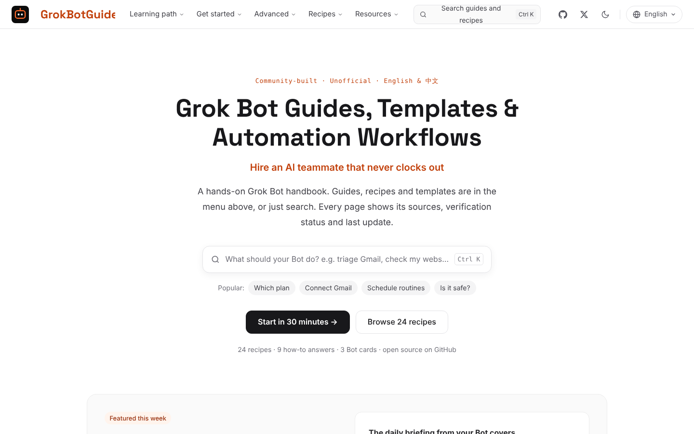
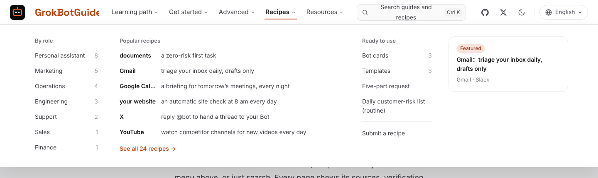
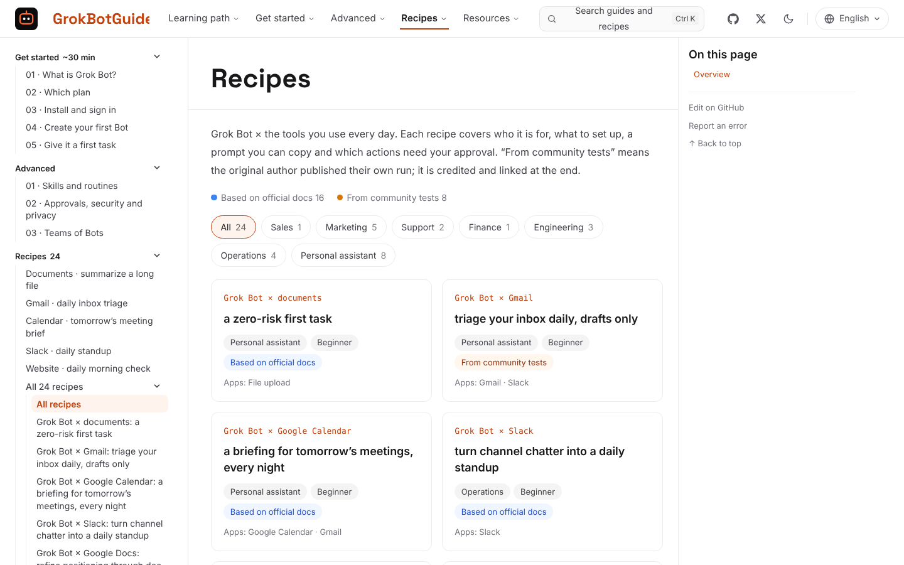
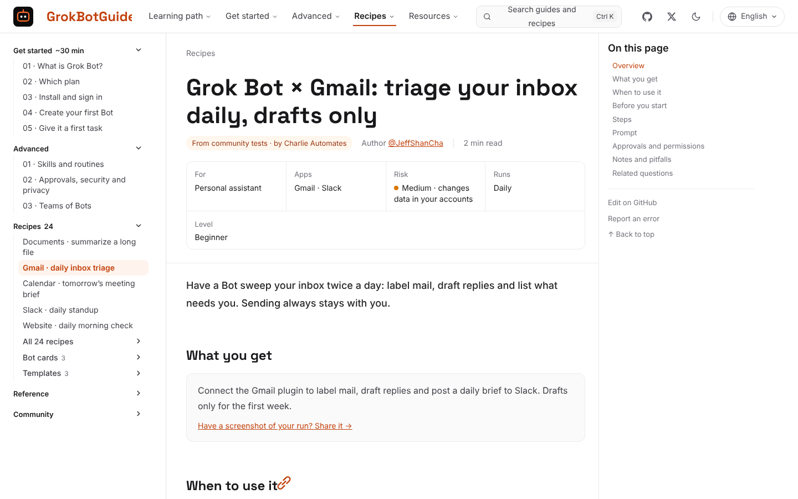
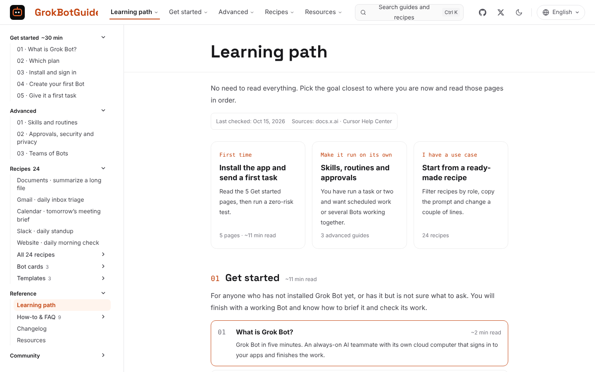
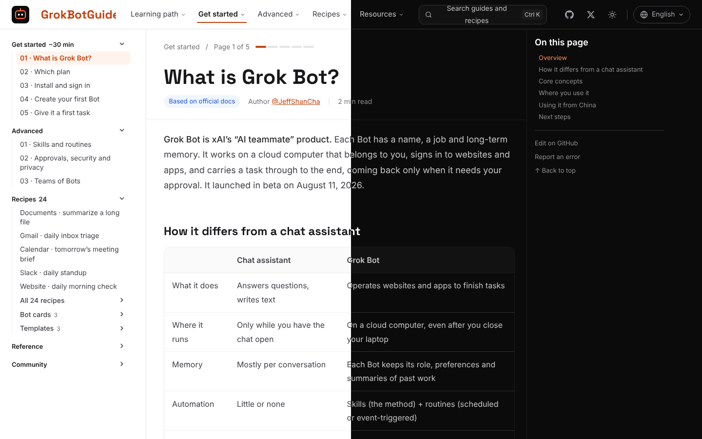
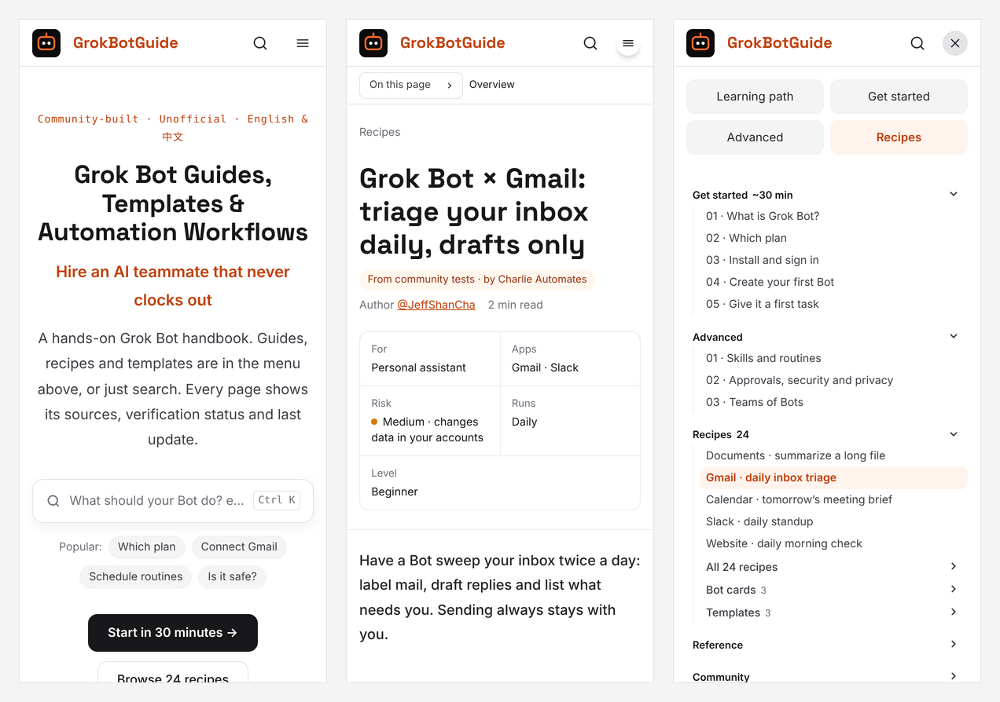

<p align="center">
  <a href="https://grokbotguide.ai/en/"></a>
</p>

<h3 align="center">A hands-on handbook for xAI Grok Bot: guides, Bot cards, templates and "Grok Bot × tool" recipes</h3>

<p align="center">
  <a href="https://grokbotguide.ai/en/"></a>
  <a href="https://github.com/JeffShanCha/grokbotguide/stargazers"></a>
  <a href="https://github.com/JeffShanCha/grokbotguide/network/members"></a>
  <a href="https://github.com/JeffShanCha/grokbotguide/issues"></a>
  <a href="./LICENSE"></a>
  <a href="./CONTENT_LICENSE.md"></a>
  <a href="./CONTRIBUTING.md"></a>
</p>

<p align="center">
  <a href="./README.md">简体中文</a>
  ·
  English
  ·
  <a href="https://grokbotguide.ai/en/">Read online</a>
  ·
  <a href="https://grokbotguide.ai/en/guide/">Learning path</a>
  ·
  <a href="https://grokbotguide.ai/en/start/what-is-grok-bot/">Get started</a>
  ·
  <a href="https://grokbotguide.ai/en/advanced/skills-and-routines/">Advanced</a>
  ·
  <a href="https://grokbotguide.ai/en/recipes/">Recipes</a>
  ·
  <a href="https://grokbotguide.ai/en/answers/">How-to & FAQ</a>
</p>

> From your first Bot to one that triages your inbox, checks your website, watches competitors and writes weekly reports every day.
> Every page shows its sources, check date and content grade. If this project saves you time, a Star helps more people find it.

## Read it online

**GrokBotGuide lives at [grokbotguide.ai](https://grokbotguide.ai/en/).** English is under `/en/` and Chinese under `/zh/`. The root domain picks a language by region, and you can switch any time from the top bar.

<p align="center">
  <a href="https://grokbotguide.ai/en/">
    
  </a>
</p>

This README gives you the overview. For learning, the website is better: full-text search, dropdown navigation, a sidebar, reading progress, one-click copyable prompts and a language switcher.

New to Grok Bot? Start with the [learning path](https://grokbotguide.ai/en/guide/). Have a use case already? Pick one from the [recipes](https://grokbotguide.ai/en/recipes/) by role.

## Why this exists

Grok Bot is not another chat box. It is xAI's "AI teammate": each Bot has a name, a job and long-term memory, and works on a cloud computer of its own. It signs in to sites and apps, takes a task from start to finish and only comes back when it needs your approval.

The hard part with a product like this is not learning the buttons. It is deciding what you can safely hand over. GrokBotGuide answers three questions:

- **How to start**: which plan, how to install, what your first Bot should own and how to brief its first task.
- **How to hand work over**: how to write clear requests, which actions must require approval, and how to turn a working flow into a skill and a scheduled routine.
- **How to use it for real work**: Gmail, Slack, X, Notion, GitHub, Stripe, Google Ads and more, each with steps, a copyable prompt and permission boundaries.

## Who it is for

- **First-time users**: five Get started pages take you from plan to first task in about 30 minutes.
- **People who want Bots running on their own**: learn skills, routines and approvals, and put manual work on a schedule.
- **Ops, marketing, support, sales and finance**: start from a recipe for your role and change a couple of lines.
- **Developers and site owners**: PR monitoring on GitHub, working with Cursor cloud agents, daily website checks.

## What you will find

| Section | What it covers |
| --- | --- |
| [Learning path](https://grokbotguide.ai/en/guide/) | Three routes (first time / run on its own / have a use case) with pages to read and reading time |
| [Get started](https://grokbotguide.ai/en/start/what-is-grok-bot/) | What Grok Bot is, which plan, install and sign in, create your first Bot, give it a first task |
| [Advanced](https://grokbotguide.ai/en/advanced/skills-and-routines/) | Skills and routines, approvals and security, teams of Bots |
| [Recipes](https://grokbotguide.ai/en/recipes/) | 24 "Grok Bot × tool" recipes, filterable by role, with risk level and run cadence |
| [Bot cards and templates](https://grokbotguide.ai/en/bots/) | Ready-made Bot descriptions and boundaries, plus briefing, skill and routine templates |
| [How-to & FAQ](https://grokbotguide.ai/en/answers/) | Nine common questions: connecting Gmail, scheduling routines, fixing problems and more |
| [Resources](https://grokbotguide.ai/en/resources/) | 100+ official docs, blog posts, videos and X posts, summarized and linked to the original |
| [Changelog](https://grokbotguide.ai/en/news/changelog/) | Product and plan changes, each with an official source |

## A quick tour

### Top navigation: every guide one click away

Five dropdown menus cover the learning path, Get started, Advanced, Recipes and Resources, including popular recipes and counts by role.

<p align="center">
  
</p>

### Recipe library: start from your role

Each card shows "Grok Bot × tool" and a one-line job, plus role, level and source grade. Click a role to filter.

<p align="center">
  
</p>

### Recipe pages: risk and cadence at a glance

A summary grid under the title shows who it is for, apps, risk level, cadence and level. The body follows the same order every time: before you start, steps, a copyable prompt, approvals and pitfalls.

<p align="center">
  
</p>

### Learning path: pick a goal, then read in order

<p align="center">
  
</p>

### Light, dark and mobile

<p align="center">
  
</p>

<p align="center">
  
</p>

## Suggested reading

### 1. First time

Read [What is Grok Bot?](https://grokbotguide.ai/en/start/what-is-grok-bot/), then [Which plan](https://grokbotguide.ai/en/start/plans/), [Install and sign in](https://grokbotguide.ai/en/start/install/), [Create your first Bot](https://grokbotguide.ai/en/start/first-bot/) and [Give it a first task](https://grokbotguide.ai/en/start/first-task/). Then try the [zero-risk recipe: summarize a long document](https://grokbotguide.ai/en/recipes/summarize-a-document/). No apps to connect.

### 2. Make it run on its own

Start with [Skills and routines](https://grokbotguide.ai/en/advanced/skills-and-routines/). Before scheduling anything, read [Approvals, security and privacy](https://grokbotguide.ai/en/advanced/approvals-and-security/). When you need several Bots, see [Teams of Bots](https://grokbotguide.ai/en/advanced/teams-of-bots/).

### 3. You have a use case

Open the [recipe library](https://grokbotguide.ai/en/recipes/) and filter by role, or start here: [Gmail inbox triage](https://grokbotguide.ai/en/recipes/gmail-inbox-triage/), [Slack daily standup](https://grokbotguide.ai/en/recipes/slack-daily-standup/), [Daily website check](https://grokbotguide.ai/en/recipes/website-daily-check/), [Reply @bot on X](https://grokbotguide.ai/en/recipes/x-tag-bot/).

## Quick links

| Page | When you need it |
| --- | --- |
| [Which plan](https://grokbotguide.ai/en/start/plans/) | The X Subscription, SuperGrok or Cursor; prices and what to know before linking |
| [Connect Gmail](https://grokbotguide.ai/en/answers/how-to-connect-grok-bot-to-gmail/) | Authorization, a drafts-only setup, and blocked work accounts |
| [Schedule routines](https://grokbotguide.ai/en/answers/how-to-schedule-grok-bot-routines/) | Time zones, minimum intervals, test runs and a checklist when a routine does not run |
| [Grok Bot not working?](https://grokbotguide.ai/en/answers/grok-bot-not-working/) | Sign-in, cloud computer, plugin and @bot problems, in the order to try |
| [Laptop closed?](https://grokbotguide.ai/en/answers/does-grok-bot-work-when-laptop-is-closed/) | The cloud computer versus your own machine |
| [Is Grok Bot safe?](https://grokbotguide.ai/en/answers/is-grok-bot-safe/) | What a shared cloud computer means and which actions need approval |
| [Five-part request](https://grokbotguide.ai/en/templates/five-part-request/) | A briefing template for any task |

## Structure

```text
GrokBotGuide
├─ guide        # Learning path
├─ start        # Get started (5 pages)
├─ advanced     # Advanced (3 pages)
├─ recipes      # 24 "Grok Bot × tool" recipes
├─ bots         # Bot cards
├─ templates    # Briefing, skill and routine templates
├─ answers      # How-to & FAQ, organised by search intent
├─ resources    # External resources, summarized and linked
├─ news         # Changelog
└─ community    # Contribute, roadmap, about
```

English and Chinese content live in `src/content/docs/en/` and `src/content/docs/zh/`, with matching file names.

## Run it locally

Requirements:

- Node.js 22.12 or later (see [`.node-version`](./.node-version))
- npm

```bash
git clone https://github.com/JeffShanCha/grokbotguide.git
cd grokbotguide
npm install
npm run dev
```

Open <http://localhost:4321/en/> for English or <http://localhost:4321/zh/> for Chinese. Edits under `src/content/docs/` reload live.

Build the static site and preview it:

```bash
npm run build
npx astro preview
```

Before sending a pull request, run the content check. It validates frontmatter, the English/Chinese pairing and duplicate resources:

```bash
npm run check:content
```

Built with [Astro](https://astro.build/) and [Starlight](https://starlight.astro.build/), with Pagefind full-text search. The live site is [grokbotguide.ai](https://grokbotguide.ai/en/).

## Principles

- **Official sources first**: features, prices, availability and security follow xAI and Cursor's official docs, with a last-checked date on key pages.
- **Honest grades**: every page says "Based on official docs", "From community tests" or "Tested here", and only pages we actually ran step by step are marked tested.
- **Beginner-friendly**: an answer you can act on first, then the steps and the why.
- **Real tasks**: fewer concepts, more copyable prompts, inputs, outputs and checks.
- **Clear safety boundaries**: wherever sending, paying, deleting, signing in or the shared cloud computer is involved, we spell out what must require approval.
- **Credit the original**: for external resources we keep only the title, our own summary, a link and the author's name.

## Sources

We cite official material first and list sources at the bottom of every page:

- [Grok Bot docs](https://docs.x.ai/grok-bot/get-started)
- [Grok Bot FAQ](https://docs.x.ai/grok-bot/faq)
- [The X Subscription plans and usage](https://docs.x.ai/x-subscription/pricing)
- [Cursor Help Center: Grok Bot](https://cursor.com/help/grok-bot/plans)
- [Official Grok Bot guides](https://x.ai/bot/guides/getting-started)

## Contributing

Contributions we would love:

- Recipes you ran yourself (with the test date and plan).
- New "Grok Bot × tool" combinations, such as Shopify, Search Console, Linear or Discord.
- Common errors and how to fix them.
- Updates and corrections when the official docs change.

If you use GitHub, open a pull request after reading the [contributing guide](./CONTRIBUTING.md). Otherwise, use the [submission form](https://grokbotguide.ai/en/community/submit/) on the site.

## License

- Site code: [MIT](./LICENSE)
- Content: [CC BY-SA 4.0](./CONTENT_LICENSE.md); credit the source and share under the same license.

## Disclaimer

GrokBotGuide is an independent community project, not affiliated with or endorsed by xAI, SpaceXAI or Cursor. Grok and related names are trademarks of their respective owners. For time-sensitive details such as features, plans, prices and availability, check the official sources.
